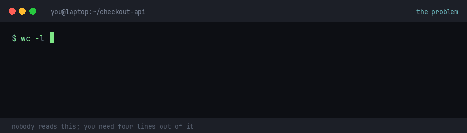

# ci-triage

<h3 align="center">CI is red → the failing step and the four lines that matter. GitHub Actions and GitLab.</h3>

<p align="center">
  <a href="LICENSE"></a>
  
  
  
</p>

<p align="center">
  
</p>

## Install

One command for each agent — the skill is plain Markdown plus a script, so nothing is coupled to one ecosystem.

```bash
# Claude Code (plugin, stays updatable)
claude plugin marketplace add ibrahimbdr/appit-skills
claude plugin install ci-triage@appit-skills

# pi
pi install git:github.com/ibrahimbdr/ci-triage

# any agent that reads a skills directory
git clone git@github.com:ibrahimbdr/ci-triage.git
cp -r ci-triage/skills/ci-triage ~/.claude/skills/      # or ~/.codex/skills/, .cursor/skills/, …
```

## Why this exists

Finding the error in a 10k-line log is the expensive part of CI debugging, not reading it. One command resolves the repo and branch, picks the newest failed run, names the failing step, and extracts the error block — nothing else enters your context.

## Use

- Why is my branch red: `scripts/ci.py failing`
- One job: `scripts/ci.py logs --job <id>`
- A log you already have: `scripts/ci.py extract path/to/log.txt --lines 60`

## Requires

- `gh` authenticated (`gh auth status`) and/or `glab` authenticated — whichever host the repo is on.
- `repo` scope for private GitHub repos.
- Python 3.9+ (stdlib only).

## What you get

- Strips ANSI, CI timestamps and boilerplate (`Downloading`, cache lines, `##[group]`), keeps ±2 lines around each error, clamps width, caps length.
- A run that failed before any job started is diagnosed as a workflow-file problem, with the `gh run view --log-failed` next step.
- Signature → cause table included (AssertionError, TS error, `npm ERR!`, timeouts, 401/403).

## Cost

| | tokens |
| --- | --- |
| always-on (the description, every session) | ~85 |
| on invoke | ~0.9k |

The demo above is regenerated from a real run: `demos/ci-triage.json` holds the captured
output, `tools/make_demo.py` renders it. No invented screenshots.

## Security

Static analysis with SkillSpector: **0/100, SAFE, 0 open findings** against the committed
baseline. Every accepted finding is listed with its reason in [SECURITY.md](SECURITY.md).
The skill never uses `shell=True`, never reads or stores a credential, and never chooses a
network destination at runtime.

## Part of the Appit collection

Browser QA · CI triage · Postgres · runbooks · SSH · Trello · cloud browsers · OpenDesign · Blender —
one marketplace: [appit-skills](https://github.com/ibrahimbdr/appit-skills).

## License

MIT. See [LICENSE](LICENSE).
